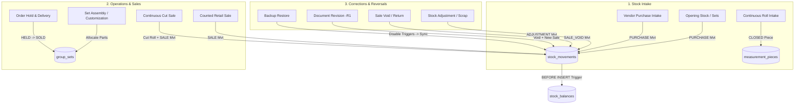
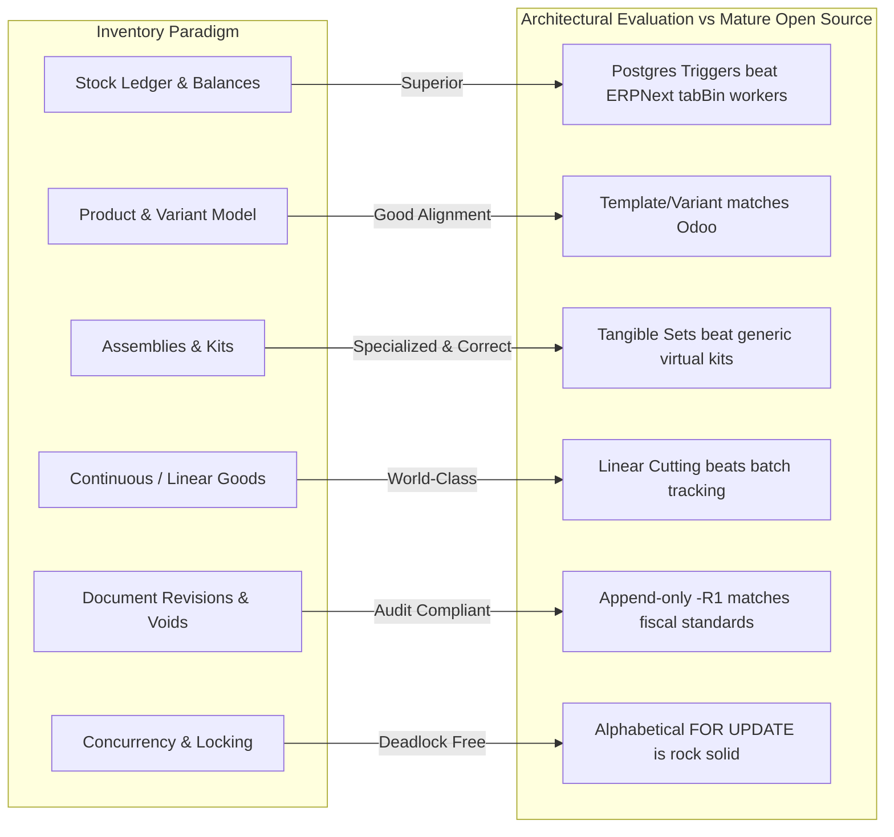

# BUSINESS WORKFLOW & GAP ANALYSIS REPORT
**Project:** RS Machinery Inventory Management System  
**Audit Date:** 2026-10-29  
**Scope:** Stages 2, 3, 4, and 5 — Product Lifecycle, Inventory Lifecycle, Open-Source Benchmarking, and Gap Analysis  
**Location:** `measurement-inventory/docs/audit/BUSINESS-WORKFLOW-GAP-ANALYSIS.md`

---

# 1. Product & Variation Lifecycle Matrix (Stage 2)

This matrix maps every operation on products, variations, attributes, and identities, establishing data-level changes, stock impacts, historical sales integrity, and safety tiers.

### 1.1 The Four Safety Tiers of Catalog Edits
1. **Tier 1: Safe Descriptive Edits:** Non-identifying marketing/display changes (names, descriptions, images, category links). Safe at all times; past invoices remain snapshot-protected.
2. **Tier 2: Commercial Edits (Needs Confirmation):** Selling price, minimum selling price, purchase cost. Affects future transactions; past committed transactions and open customer contracts remain immutable.
3. **Tier 3: Identity Changes (Requires Migration / Replacement):** SKUs, short names, adding/retiring variations. Requires uniqueness validation and retirement workflows.
4. **Tier 4: Physical Invariant Changes (MUST BE REJECTED):** Changing length units (`m` to `ft_in`), decimals, or roll scrap thresholds on items with ledger history. Must be rejected to prevent mathematical corruption.

---

### 1.2 Comprehensive Lifecycle Operations Table

| # | Operation | Safety Tier | Records Read & Written | Stock Quantities Changed? | Physical Pieces Affected? | Historical Sales & Purchases Accurate? | Outstanding Orders Affected? | Uniqueness & Referential Integrity | Transactional & Failure Behavior | Reversibility |
|---|---|---|---|---|---|---|---|---|---|---|
| **1** | **Create Product** | Tier 3 (Identity) | Writes: `product_groups`, `product_variations`, `group_byproducts` (if grouped), `product_categories`. | **No** (Starts at 0) | No pieces created | N/A (New product) | None | Enforces unique `short_name` per company via `assertCodesFree`. | Atomic in `prisma.$transaction`. Duplicate code throws 409 `SHORT_NAME_TAKEN`. | Reversible by deactivating or deleting if unused. |
| **2** | **Add Variation** | Tier 3 (Identity) | Writes: `product_variations`. | **No** (Starts at 0) | No pieces created | Completely unaffected | None | Enforces batch attribute uniqueness and code freedom. | Atomic. Duplicate combination throws 400 `DUPLICATE_VARIATION`. | Can be retired (`active=false`). |
| **3** | **Edit Variation Attributes** | Tier 4 (Physical) | Reads: `stock_movements`. Writes: `product_variations.attributes`. | **No** | Pieces retain old attribute snapshot | Protected | Open order lines retain attribute snapshot | `assertAttributeEditSafe()`: Blocked if *any* movements exist in `stock_movements`. | Rejects with 400 `CANNOT_EDIT_ATTRIBUTES` if ledger history exists. | Irreversible if blocked; must create new variation instead. |
| **4** | **Change Product Name / Description** | Tier 1 (Safe) | Writes: `product_groups.name`, `description`. | **No** | None | **100% Immutable:** Historical lines carry `product_name_snapshot`. | Order lines retain snapshot taken at order placement. | Unconstrained | Atomic single-row update. | Fully reversible. |
| **5** | **Change Selling Price / Cost** | Tier 2 (Commercial) | Writes: `product_variations.sale_price`, `purchase_cost`, `group_set_types.sale_price`. | **No** | None | **100% Immutable:** Past sales carry committed `unit_price`; purchases carry `unit_cost`. | Contracted orders retain agreed `order_lines.price`. | Values must be >= 0 (`CHECK` constraint) | Atomic. If `sale_price < min_sale_price`, throws 400. | Fully reversible. |
| **6** | **Change SKU / Short Name** | Tier 3 (Identity) | Writes: `product_variations.short_name`, `official_sku`. | **No** | Piece codes remain unchanged (they use date/seq) | **100% Immutable:** Document lines carry `short_name_snapshot`. | Orders retain `short_name_snapshot`. | `assertCodesFree()` checks uniqueness across all active/archived variations. | Rejects with 409 if new code is taken. | Reversible to original code if available. |
| **7** | **Change Measurement Unit (`m` to `ft_in`)** | Tier 4 (Physical) | Reads: `stock_movements`, `measurement_pieces`. | **CORRUPTION RISK** | Mathematical length mismatch | Past transactions become uninterpretable | Open orders deliver wrong physical units | Check constraint `product_groups_measured_settings` | **Strictly Rejected:** Application blocks change if movements exist. | Irreversible; replacement product required. |
| **8** | **Retire a Variation** | Tier 3 (Identity) | Writes: `product_variations.active = false`. | **No** (Stock stays on balance) | Pieces remain in inventory | Past transactions completely intact | Existing open orders can fulfill; new lines blocked | Referential integrity preserved | Atomic. Prevents adding to new carts via `assertActiveItem`. | Reversible (`active = true`). |
| **9** | **Archive Product** | Tier 1 (Safe) | Writes: `product_groups.active = false`. | **No** (Stock stays on balance) | Pieces remain visible in inventory reports | Past transactions completely intact | Cannot create new orders/sales; existing orders fulfill | Referential integrity preserved | Atomic. Displays warning if archived with remaining stock. | Reversible (`restore`). |
| **10** | **Delete Product** | Tier 3 (Destructive) | Deletes: `product_groups`, `product_variations`. | **Blocked if stock exists** | Blocked if pieces exist | Blocked if sales/purchases exist | Blocked if orders exist | PostgreSQL `ON DELETE RESTRICT` foreign keys on all transaction tables. | Database rejects with `P2003` foreign key violation if history exists. | Irreversible once purged. |

---

# 2. Inventory Lifecycle Execution Traces (Stage 3)

We traced 14 core inventory workflows from request origin to database triggers and final stock balances.



### Trace Details for the 14 Workflows

1. **Initial Stock Receipt (Opening Sets / Stock In):**  
   - *Origin:* `POST /api/sets/opening` or `POST /api/sets/types/:id/stock-in`.
   - *Execution:* `addOpeningSets()` in `sets.ts:268`. Generates sequential set code (`CH-4MM-3M-2910-01`), creates `group_sets` (`status = 'IN_STOCK'`), creates synthetic `CUT` pieces (`setOrigin = true`), and writes `PURCHASE` stock movements.
   - *Balance Effect:* Trigger `stock_movements_maintain_balance` increments `stock_balances`.
2. **Subsequent Stock Receipt (Vendor Purchase):**  
   - *Origin:* `POST /api/purchases` (`documents.ts:163`).
   - *Execution:* Writes `purchases` and `purchase_lines`. Calls `receiveRolls()` for measured goods (creates `CLOSED` rolls) and `createSets()` for hoists. Writes `PURCHASE` stock movements.
   - *Balance Effect:* Increments company and warehouse stock balances. Auto-records vendor rates in `vendor_prices`.
3. **Normal Retail Sales (Counted Goods):**  
   - *Origin:* `POST /api/sales` (`documents.ts:163`).
   - *Execution:* Writes `sales` and `sale_lines`. Emits negative `SALE` stock movements. Trigger `stock_movements_no_negative` verifies available stock unless negative stock override is permitted.
4. **Stock Reservations & Order Holds:**  
   - *Origin:* `POST /api/orders` (`orders.ts:402`).
   - *Execution:* Sets status to `PLACED`. Grouped sets allocated to order lines update to `status = 'HELD', orderId = id`. Free stock query excludes held sets. Order cancellation restores sets to `IN_STOCK`.
5. **Partial Sales & Order Deliveries:**  
   - *Origin:* `POST /api/orders/:id/fulfill` (`orders.ts:546`).
   - *Execution:* Generates delivery sale for fulfilled lines. `order-sync.ts` updates `fulfilledQuantity`. When all lines reach 100%, order auto-transitions to `COMPLETED`.
6. **Continuous Goods Cutting:**  
   - *Origin:* `POST /api/sales` with measured lines (`measure.ts:653`).
   - *Execution:* `cutForSale()` queries active rolls, selects shortest fitting piece, decrements `remainingLength`, sets status `USED_UP` if 0, logs `measurement_piece_ledger` (`SALE`), and emits negative `SALE` movement.
7. **Bundle State Transitions (`CLOSED` -> `OPEN` -> `USED_UP`):**  
   - *Origin:* First cut on a sealed roll (`measure.ts:485`).
   - *Execution:* First cut automatically updates `kind = 'OPEN'`. Subsequent cuts reduce length until 0, transitioning status to `USED_UP`.
8. **Physical Set Assembly & Customization:**  
   - *Origin:* Set purchase intake or `prepareSaleSets()` (`sets.ts:157, 427`).
   - *Execution:* Allocates constituent parts in `group_set_parts`. Trigger `set_parts_free_stock` ensures balance exceeds allocated parts.
9. **Inventory Adjustments (Cycle Counts):**  
   - *Origin:* `POST /api/inventory/adjustments`.
   - *Execution:* Writes `ADJUSTMENT` movement with delta quantity. Counted items adjust directly; measured goods require explicit roll correction via `correctLength()`.
10. **Scrap & Damage Write-Offs:**  
    - *Origin:* `POST /api/measure/pieces/:id/write-off`.
    - *Execution:* Marks piece `status = 'USED_UP', remainingLength = 0`, logs `measurement_piece_ledger` (`WRITE_OFF`), and writes negative `WRITE_OFF` movement.
11. **Sale Cancellation (Document Void):**  
    - *Origin:* `POST /api/sales/:id/void` (`documents.ts:513`).
    - *Execution:* Creates `document_voids` row. Calls `restoreSaleCuts()` (restores roll lengths or creates new cut piece) and `restoreSaleSets()` (marks sets `IN_STOCK`). Writes compensating `SALE_VOID` movements (`+qty`).
12. **Document Revisions (Replaced Chain):**  
    - *Origin:* `POST /api/sales/:id/edit` (`documents.ts:641`).
    - *Execution:* Atomic replacement: Voids original sale with `kind = 'REPLACED'`, emits `SALE_VOID` movements, restores cuts/sets, and calls `writeDocument()` to create `-R1` invoice with new `SALE` movements.
13. **Archived Product Stock Depletion:**  
    - *Origin:* Legacy inventory depletion.
    - *Execution:* Archived products retain physical balances. Sales are blocked, but returns or adjustments are permitted.
14. **Disaster Recovery Restore:**  
    - *Origin:* `POST /api/backup/restore` (`backup.ts:180`).
    - *Execution:* Disables row triggers, bulk inserts raw data, re-enables triggers, and restores stored balances.

---

# 3. Open-Source Benchmarking (Stage 4)

We benchmarked RS Machinery against three major open-source systems: **ERPNext**, **Odoo**, and **InvenTree**.



### Detailed Evaluation of the 9 Core Concepts

#### 1. Stock Movement History & Current Balances
- **Reference Approach:**
  - *ERPNext:* Append-only `tabStock Ledger Entry` (SLE). A separate `tabBin` table caches quantities. Background jobs recalculate bins, frequently causing concurrency lock contention and drift.
  - *Odoo:* `stock.move` records transfers between locations. `stock.quant` tracks current quantities per location using database constraints.
- **RS Machinery Reality:**
  - Append-only `stock_movements` ledger.
  - `stock_balances` and `warehouse_stock_balances` maintained synchronously via PostgreSQL `BEFORE INSERT OR DELETE` row triggers (`0007_stock_balances`).
  - View `stock_balance_drift` continuously monitors mathematical equality:
    $$\text{stock\_balances.quantity} = \sum \text{stock\_movements.quantity}$$
- **Architectural Verdict:** **RS Machinery is superior to ERPNext.** Synchronous database triggers eliminate the asynchronous queue lags and race conditions common in ERPNext.

#### 2. Product and Variant Identity
- **Reference Approach:**
  - *Odoo:* Separates `product.template` (commercial definition, marketing, general configurations) from `product.product` (tangible SKU, attribute values, inventory tracking).
  - *InvenTree:* Separates `Part` from `PartVariant`.
- **RS Machinery Reality:**
  - Clean separation: `product_groups` represents the commercial template; `product_variations` represents physical stock SKUs.
  - *The Gap:* Migration `0041` introduced `group_set_types` with distinct prices, creating two competing price locations (`ProductVariation.salePrice` vs `GroupSetType.salePrice`).
- **Architectural Verdict:** Excellent structural alignment with Odoo. The pricing bifurcation must be resolved by establishing `group_set_types` as the sole authority.

#### 3. Kits vs Physical Assemblies
- **Reference Approach:**
  - *ERPNext & Odoo:* Use "Phantom Bills of Material" (Kits/Bundles). Parts remain loose in the warehouse and are only exploded and deducted *at the moment of delivery*.
  - *InvenTree:* Requires a formal `Build Order` to consume loose parts and instantiate a tracked sub-assembly.
- **RS Machinery Reality:**
  - Chain hoists are tangible physical assemblies (`group_sets`). When a hoist is received or built, parts are physically bolted together.
  - Parts are locked inside the set (`group_set_parts` with `status = 'ALLOCATED'`).
  - Free stock formula strictly prevents loose sales from taking parts fitted inside hoists:
    $$\text{Free Stock} = \text{Balance} - \sum \text{ALLOCATED parts}$$
- **Architectural Verdict:** **RS Machinery's physical set model is strictly correct.** In heavy industrial machinery, hoist bodies and fitted load chains cannot be treated as virtual kits. Loose selling would permit overselling hoists that are already physically assembled.

#### 4. Continuous / Linear Goods (Ropes, Chains, Hoses)
- **Reference Approach:**
  - *ERPNext & Odoo:* No native concept of linear continuous goods with cut lineage. Ropes are tracked as plain batch quantities. Offcut scrap must be calculated manually in spreadsheets.
  - *InvenTree:* Allows splitting a `StockItem`, but lacks automated shortest-fit piece planning and dual feet/inch fractional math.
- **RS Machinery Reality:**
  - First-class `measurement_pieces` with parent/child cutting lineage (`parent_id`), scrap thresholds (`scrap_below`), piece actions (`OPEN`, `CUT`, `SALE`), and dual unit systems (`m` vs `ft_in`).
- **Architectural Verdict:** **RS Machinery has a world-class specialized domain engine.** Generic ERPs fail in this domain. This engine must be preserved intact.

#### 5. Returns, Cancellations, and Historical Integrity
- **Reference Approach:**
  - *Odoo & ERPNext:* Commercial documents are never mutated. Invoices are cancelled via reversing `Credit Notes` and compensating return moves.
- **RS Machinery Reality:**
  - Append-only `document_voids` and revision chains (`INV/...-R1`).
  - Compensating movements (`SALE_VOID`, `PURCHASE_VOID`).
  - Immutable historical snapshots (`product_name_snapshot`, `short_name_snapshot`).
- **Architectural Verdict:** 100% compliant with international accounting and auditing standards.

#### 6. Concurrency and Locking
- **Reference Approach:**
  - *ERPNext:* Relies on Redis locks and MariaDB `FOR UPDATE` on `tabBin`. Invoices with lines in arbitrary order frequently deadlock.
  - *Odoo:* PostgreSQL row locking ordered by product ID.
- **RS Machinery Reality:**
  - In `stock.ts:lockVariations()`, all variation IDs are strictly sorted alphabetically:
    ```sql
    SELECT v.id FROM product_variations v WHERE v.id = ANY(ids) ORDER BY v.id FOR UPDATE OF v;
    ```
- **Architectural Verdict:** **Industrial Grade.** Deterministic lock ordering guarantees zero deadlocks across concurrent multi-counter sales desks.

---

# 4. Prioritized Gap Analysis Matrix (Stage 5)

Every confirmed gap is classified with source evidence, business consequences, and actionable corrections:

| Gap ID | Classification | Source Evidence | Business Consequence | Proposed Architectural Correction | Implementation Effort & Risk |
|---|---|---|---|---|---|
| **GAP-01** | **Confirmed Architectural Weakness** | `documents.ts:398`<br/>`sets.ts:427, 541` | Dynamic chain replacement runs inside `writeDocument`. Widens transaction lock window and complicates returns/revisions. | Decouple set customization into a dedicated endpoint `POST /api/sets/:id/customize`. Sales checkout becomes single-phase. | **Effort: Medium** (3 days)<br/>**Risk: Low** |
| **GAP-02** | **Confirmed Defect** | `schema.prisma:355, 1245`<br/>`set-types.ts:83` | Grouped products store prices in both `ProductVariation` and `GroupSetType`. Staff quote wrong rates to clients. | Deprecate `ProductVariation.salePrice` for grouped items. Establish `GroupSetType` as sole pricing authority. | **Effort: Low** (1 day)<br/>**Risk: Very Low** |
| **GAP-03** | **Performance Concern** | `inventory-query.ts:54-150` | Full table scan and aggregation on `group_set_parts` on every catalog search keystroke. Search slows as set history grows. | Add composite index `(company_id, status, variation_id)` on `group_set_parts`; cache allocated quantities on `stock_balances`. | **Effort: Low** (1 day)<br/>**Risk: Very Low** |
| **GAP-04** | **Missing Business Rule** | `routes/products.ts:240` | Allows editing product category heads and attributes even if active open sale orders hold reservations. | Changing category attributes while orders are held can cause inconsistencies when order lines are fulfilled. | Prevent modifying attribute definitions if open orders (`status IN ('PLACED', 'ON_DELIVERY')`) exist for that variation. | **Effort: Low** (1 day)<br/>**Risk: Very Low** |
| **GAP-05** | **Unnecessary Complexity** | `shared/src/sets.ts:200` | 250-line client-side solver guesses piece allocations, causing unexpected 409 `PIECE_CHANGED` errors at checkout. | Eliminate client guessing. Client requests desired set specifications; server returns authoritative plan. | **Effort: Medium** (2 days)<br/>**Risk: Low** |
| **GAP-06** | **Disaster Recovery Gap** | `routes/backup.ts:restore()` | Triggers disabled during backup restore; does not verify `stock_balance_drift` post-restore. | Silent balance drift if backup archive has pre-existing corruption. | Add automated post-restore check: Query `stock_balance_drift`. If drift > 0, trigger automatic ledger recalculation. | **Effort: Low** (0.5 days)<br/>**Risk: Very Low** |

---

# 5. Conclusion & Strategic Guidance

RS Machinery's codebase represents a **high-quality, specialized domain application** that outperforms generic ERPs (ERPNext, Odoo) in physical assembly tracking and continuous linear goods cutting.

The system does NOT need a fundamental rewrite or database redesign. The required modernization is strictly focused on **streamlining application-level transaction boundaries**:
1. Unifying pricing authority into `group_set_types`.
2. Decoupling shop-floor chain customization from the commercial sales invoice pipeline.
3. Modularizing `documents.ts` to reduce maintenance costs.
4. Indexing `group_set_parts` for high-speed catalog browsing.
