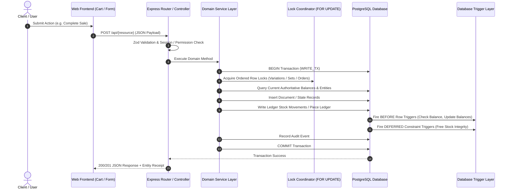
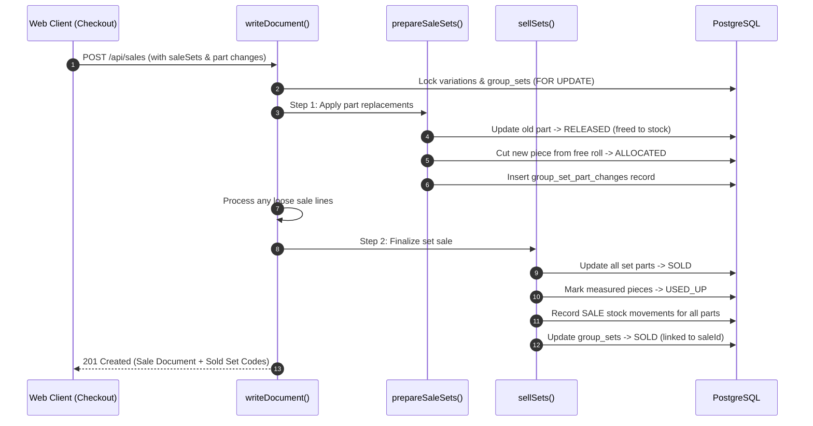

# DATA FLOW AUDIT
**Project:** RS Machinery Inventory Management System  
**Audit Date:** 2026-10-28  
**Auditor:** Principal Software Architect & Senior Data Engineer  
**Scope:** Verified Request-to-Commit Execution Traces Across 10 Critical System Workflows

---

## 1. Overview of Execution Pipelines

Every critical commercial and inventory state change in the system follows a deterministic transactional pipeline:

---

## 2. Workflow Traces

### Workflow 1: Normal Product Creation (Simple, Variable, Measured, Grouped)
**Trigger Origin:** `app/web/components/products/ProductForm.tsx` via `POST /api/products`

1. **Validation:**
   - Evaluated by `createProductBody` in `app/api/src/routes/products.ts`.
   - Checks: Name presence, type enum (`simple`, `variable`, `measured`, `grouped`), unique short names, attribute definitions, length unit rules.
2. **Business Rules:**
   - A Measured product requires `lengthUnit` (`m` or `ft_in`) and positive roll defaults (`0021_measured_stock`).
   - A Grouped product creates an internal `simple` product as its `mainComponent` (`ownerGroupId = group.id`), hidden from loose sales (`app/api/src/lib/product-create.ts:133-149`).
   - By-product links cannot link to another `grouped` product or another group's `mainComponent`.
3. **Execution Path:**
   - Router: `app/api/src/routes/products.ts:114`
   - Service: `createPlainProduct()` or `createGroupedProduct()` in `app/api/src/lib/product-create.ts:24, 88`.
4. **Database Operations & Transaction:**
   - Bound by `prisma.$transaction(WRITE_TX)`.
   - Reads: Category existence (`assertActiveCategory`), variation code collision check (`assertCodesFree` querying `product_variations`).
   - Writes: `product_groups.create`, `product_variations.createMany`, `group_byproducts.createMany`, `audit_events.create`.
5. **Failure Handling:**
   - Any duplicate SKU/shortName triggers `P2002` or `AppError(409, "SHORT_NAME_TAKEN")`, rolling back the entire group and all variations atomically.

---

### Workflow 2: Inventory Intake — Counted Purchase
**Trigger Origin:** `app/web/components/Checkout.tsx` via `POST /api/purchases`

1. **Validation:**
   - `createDocumentBody` in `app/api/src/lib/documents.ts`. Validates lines, vendor ID, prices, quantities, payment modes.
2. **Business Rules:**
   - Multiplies line quantities by `+1` (incoming).
   - Generates sequential purchase number (`PUR/2026-27/0001`).
   - Automatically records vendor price history if supplier ID provided.
3. **Execution Path:**
   - `createDocument(cfg, ctx, body)` -> `writeDocument(tx, cfg, ctx, body)` in `app/api/src/lib/documents.ts:163, 197`.
4. **Database Operations & Transaction:**
   - Reads: `loadParty()`, `resolveWarehouse()`, `productVariation.findMany()`.
   - Writes:
     - `purchases.create()`, `purchase_lines.createMany()`.
     - `stock_movements.createMany()` with `movementType = 'PURCHASE'`.
     - `vendor_prices.upsert()`, `vendor_price_history.create()`.
     - Trigger `stock_movements_maintain_balance` increments `stock_balances.quantity` and `warehouse_stock_balances.quantity`.
     - `audit_events.create()`.
5. **Failure Handling:**
   - Deadlocks prevented by sorting variation IDs prior to write. Any constraint violation rolls back the purchase and stock balance updates.

---

### Workflow 3: Inventory Intake — Measured Goods (Roll Receiving)
**Trigger Origin:** `app/web/components/Checkout.tsx` (Purchase mode) or `/api/measure/variations/:id/rolls`

1. **Validation:**
   - Array of rolls with lengths in base units (`m` or `ft_in`).
2. **Business Rules:**
   - Each roll becomes a distinct physical `measurement_pieces` record with `kind = 'CLOSED'` and unique roll code (`RO-4MM-2610-01`).
   - Sum of roll lengths must match purchase line quantity exactly (`documents.ts:281-285`).
3. **Execution Path:**
   - `writeDocument()` calls `receiveRolls()` in `app/api/src/lib/measure.ts:423`.
4. **Database Operations & Transaction:**
   - Atomic with the purchase transaction.
   - Reads: `piece_counters` row FOR UPDATE (`allocatePieceSequences()`).
   - Writes:
     - `measurement_pieces.createMany()` (one row per physical roll).
     - `measurement_piece_ledger.createMany()` with `action = 'RECEIVE'`.
     - `stock_movements.createMany()` for the variation total.
     - `stock_balances` updated by database trigger.
5. **Failure Handling:**
   - Roll sequence counter increments rollback if any insert fails.

---

### Workflow 4: Inventory Intake — Grouped Sets Purchase & Opening Sets
**Trigger Origin:** `app/web/components/sets/PurchaseSetsModal.tsx` or `SetSheet.tsx` via `POST /api/sets/opening`

1. **Validation:**
   - Validated by `setInput` in `app/api/src/lib/sets.ts:24-42`.
   - Ensures all required by-products are present; measured parts carry length.
2. **Business Rules:**
   - Grouped products never have stock movements of their own (`stock_movements_not_grouped` trigger).
   - Stock movements are generated for every constituent part (main component + by-products).
   - Generates fixed set code: `{SET-SKU}-{part tokens}-{DD-MM-YY}-{seq}` (`sets.ts:88-105`).
   - Measured parts become synthetic `CUT` pieces with `setOrigin = true` and `setId = set.id`.
3. **Execution Path:**
   - `createSets()` in `app/api/src/lib/sets.ts:157`.
4. **Database Operations & Transaction:**
   - Writes:
     - `group_sets.create()` with `status = 'IN_STOCK'`.
     - `group_set_parts.createMany()` with `status = 'ALLOCATED'`.
     - `measurement_pieces.createMany()` for measured by-products.
     - `stock_movements.createMany()` with `movementType = 'PURCHASE'` for each part.
5. **Failure Handling:**
   - Constraint trigger `set_parts_free_stock` ensures running balance matches or exceeds allocated parts.

---

### Workflow 5: Normal Sales — Counted Items & Multi-Warehouse Split
**Trigger Origin:** `app/web/components/Checkout.tsx` via `POST /api/sales`

1. **Validation:**
   - Checked by `createDocumentBody`. Enforces whole integer quantities for counted goods.
2. **Business Rules:**
   - Deducts stock via `movementType = 'SALE'` with negative quantity.
   - Checks negative stock policy (`STRICT` vs `WARN_AND_ALLOW` vs `MANAGER_OVERRIDE`).
   - Splitting lines across warehouses generates one `stock_movements` row per split location.
3. **Execution Path:**
   - `writeDocument()` -> `recordMovements()` in `app/api/src/lib/stock.ts:128`.
4. **Database Operations & Transaction:**
   - Reads: Locks variations via `lockVariations()` (`SELECT ... FOR UPDATE`).
   - Balance check: Verifies `freeBalances()`.
   - Writes:
     - `sales.create()`, `sale_lines.createMany()`.
     - `stock_movements.createMany()`.
     - Trigger `stock_movements_maintain_balance` decrements balances.
     - Trigger `stock_movements_no_negative` blocks commit if insufficient stock under strict policy.
5. **Failure Handling:**
   - If stock is insufficient, throws `AppError(409, "INSUFFICIENT_STOCK")`. Entire transaction is aborted.

---

### Workflow 6: Normal Sales — Measured Stock Cutting
**Trigger Origin:** `app/web/components/ProductDrawer.tsx` / `Checkout.tsx`

1. **Validation:**
   - Quantity represents desired cut length. Optional `pieceId` represents chosen roll.
2. **Business Rules:**
   - Measured goods stock can NEVER go below zero (`stock_movements_no_negative` trigger).
   - Cuts must be sourced from a single active piece; pieces can never be joined (`DM-4`).
3. **Execution Path:**
   - `writeDocument()` calls `cutForSale()` in `app/api/src/lib/measure.ts:653`.
4. **Database Operations & Transaction:**
   - Reads: `activePieces()` under variation locks.
   - Algorithm: `planCuts()` finds shortest fitting piece (Cut -> Open -> Closed).
   - Writes:
     - `measurement_pieces.update()` (reduces `remaining_length`; marks `USED_UP` if 0).
     - If roll was `CLOSED`, changes kind to `OPEN`.
     - `measurement_piece_ledger.create()` with `action = 'SALE'`.
     - `stock_movements.create()` for cut length.
5. **Failure Handling:**
   - If the chosen piece was modified concurrently, throws `AppError(409, "PIECE_CHANGED")`.

---

### Workflow 7: Exceptional Sales — Grouped Set Sale with Component Replacement
**Trigger Origin:** `app/web/components/sets/SaleSetsModal.tsx` -> `Checkout.tsx` -> `POST /api/sales`

1. **Validation:**
   - Payload contains `saleSets: [{ setId, version, changes: [{ byproductId, action: "REPLACE", variationId, length }] }]`.
2. **Business Rules:**
   - Set must be `IN_STOCK` and match the submitted version.
   - Old part is released back to free stock (measured part returns as an active `CUT` piece with its exact length).
   - New part is taken from free stock (measured part cut from an active free roll/piece).
   - Set sale price is dynamically repriced: `BaseSetPrice - OldPartPrice + NewPartPrice` (`GROUPED-PRODUCTS-V3-PLAN.md:D12`).
3. **Execution Path:**
   - Dual-phase execution inside `writeDocument()`:
     - **Phase 1 (Preparation):** `prepareSaleSets()` in `app/api/src/lib/sets.ts:427`.
     - **Phase 2 (Sale Execution):** `sellSets()` in `app/api/src/lib/sets.ts:541`.
4. **Database Operations & Transaction:**
   - Reads: Locks all affected variations in alphabetical order, then locks `group_sets` FOR UPDATE.
   - Writes in Phase 1:
     - Old `group_set_parts` row updated to `status = 'RELEASED'`.
     - If measured, old piece `setId = null`, ledger logs `SET_RELEASE`.
     - New measured part: `cutPiece()` cuts required length from free piece, updates new piece `setId = set.id`, ledger logs `SET_ALLOCATE`.
     - New `group_set_parts` created with `status = 'ALLOCATED'`.
     - Append-only `group_set_part_changes` record created.
   - Writes in Phase 2:
     - All currently allocated parts marked `status = 'SOLD'`.
     - Constituent pieces marked `status = 'USED_UP', remainingLength = 0`, ledger logs `SALE`.
     - `stock_movements.createMany()` generated for every individual part.
     - `group_sets` updated to `status = 'SOLD', saleId = doc.id`.
5. **Failure Handling:**
   - If replacement stock is missing, throws `AppError(409, "NO_PIECE_LONG_ENOUGH")` or `PART_NOT_IN_STOCK`. No stock or parts are modified.

---

### Workflow 8: Returns & Cancellations (Document Voids)
**Trigger Origin:** `app/web/components/DocumentView.tsx` via `POST /api/sales/:id/void`

1. **Validation:**
   - Validates reason text (minimum 3 characters) and optional `releaseSetIds`.
2. **Business Rules:**
   - Sales and purchases are NEVER deleted. A void creates an immutable `document_voids` entry.
   - Emits compensating stock movements (`SALE_VOID` or `PURCHASE_VOID`) with opposite signed quantities.
   - Sets sold on the sale are restored to `IN_STOCK` with the parts they were sold with (`D15`).
   - If user opted to release measured parts (`releaseSetIds`), those parts return as free `CUT` pieces in normal stock (`sets.ts:608-620`).
3. **Execution Path:**
   - `voidDocument()` in `app/api/src/lib/documents.ts:513`.
4. **Database Operations & Transaction:**
   - Reads: Locks document FOR UPDATE. Checks for existing void.
   - Writes:
     - `document_voids.create()`.
     - `restoreSaleCuts()` restores measured piece lengths (or creates new pieces if original altered).
     - `restoreSaleSets()` reallocates parts and marks sets `IN_STOCK`.
     - `recordMovements()` writes `SALE_VOID` movements.
     - `syncOrderFromDocuments()` re-opens any linked customer order.
5. **Failure Handling:**
   - Purchase void is BLOCKED if any received stock has already been sold (`AppError(409, "STOCK_ALREADY_USED")`).
   - Purchase void of grouped sets is BLOCKED if any set was modified, held, or sold (`AppError(409, "SET_CHANGED_OR_SOLD")`).

---

### Workflow 9: Document Edits & Revisions (The Revision Chain)
**Trigger Origin:** `app/web/components/Checkout.tsx` (in edit mode) via `POST /api/sales/:id/edit`

1. **Validation:**
   - Validates `expectedNumber`, financial year boundary (FY cannot change).
2. **Business Rules:**
   - Replaces the original document with an append-only revision suffix (`INV/2026-27/0001-R1`).
   - Original document is voided with `kind = 'REPLACED'`.
   - Original stock movements are reversed (`SALE_VOID`), and new document movements (`SALE`) are applied.
   - Sold sets return to stock as sold and are immediately re-sold under the revision (`documents.ts:745-775`).
3. **Execution Path:**
   - `editDocument()` in `app/api/src/lib/documents.ts:641`.
4. **Database Operations & Transaction:**
   - Entire replacement executes in one atomic transaction.
   - Locks original document and linked order.
   - Restores cuts and sets from original sale.
   - Writes compensating void movements.
   - Writes new revision document via `writeDocument()`.
   - Links original void record to `replacedBySaleId`.
5. **Failure Handling:**
   - If new lines violate stock or pricing invariants, the transaction aborts. Original document remains valid and untouched.

---

### Workflow 10: Customer Order Fulfillment & Synchronization
**Trigger Origin:** `app/web/components/orders/OrderView.tsx` via `POST /api/orders/:id/fulfill`

1. **Validation:**
   - Checked by `fulfillOrderBody` in `app/api/src/lib/orders.ts:546`.
2. **Business Rules:**
   - Orders do not move stock directly; they hold stock or establish delivery obligations.
   - Fulfilling an order executes `writeDocument()` inside the fulfillment transaction.
   - Sets held by the order (`status = 'HELD'`) are unheld for delivery and sold on the resulting invoice (`orders.ts:660-665`).
   - `order-sync.ts` evaluates outstanding delivered quantities across all linked live documents and automatically transitions order status: `PLACED` -> `PARTIALLY_FULFILLED` -> `COMPLETED`.
3. **Execution Path:**
   - `fulfillOrder()` -> `unholdForDelivery()` -> `writeDocument()` -> `syncOrderFromDocuments()`.
4. **Database Operations & Transaction:**
   - Locks order row FOR UPDATE.
   - Calls `writeDocument()` which locks variations and sets.
   - Updates `order_lines.fulfilled_quantity` and `orders.status`.
   - Writes `order_events` entry logging the status transition.
5. **Failure Handling:**
   - If partial stock is missing or set is unavailable, fulfillment fails atomically; order status and held items remain intact.

