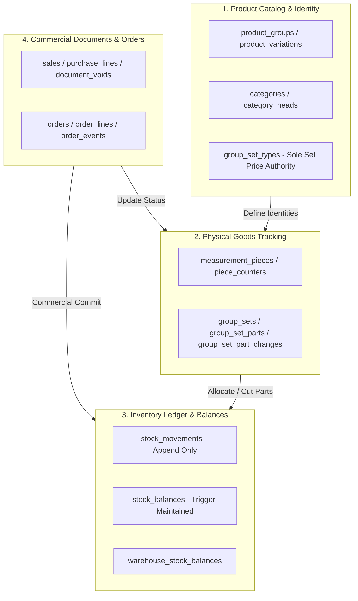
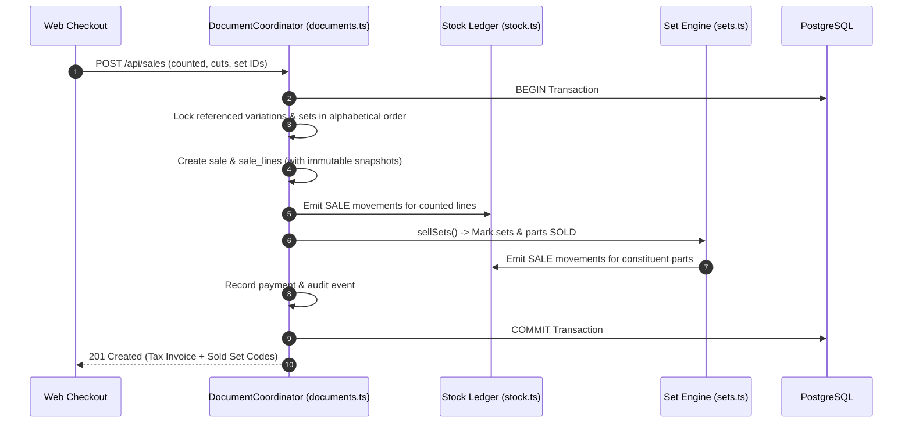
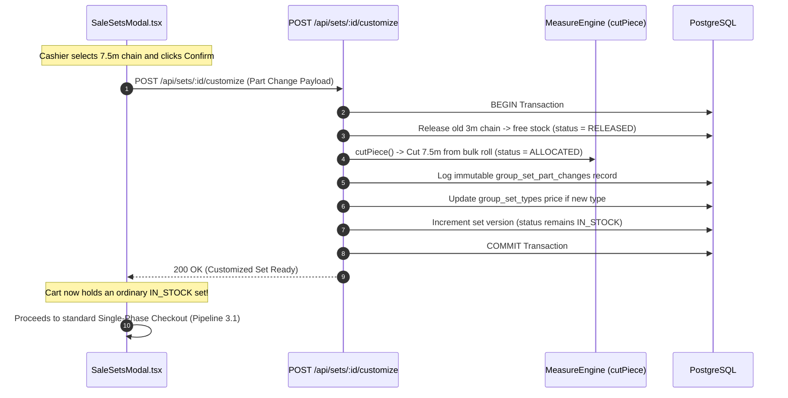

# RECOMMENDED TARGET ARCHITECTURE (REVISED)
**Project:** RS Machinery Inventory Management System  
**Audit Date:** 2026-10-29 (Revision 2 Post-Lifecycle Investigation)  
**Auditor:** Principal Software Architect & Senior Data Engineer  
**Scope:** Architectural Target State, Bounded Contexts, and Simplification Strategy  
**Location:** `measurement-inventory/docs/audit/RECOMMENDED-TARGET-ARCHITECTURE.md`

---

## 1. Architectural Principles & Invariants

The target architecture is governed by five pragmatic principles:

1. **Optimize the High-Frequency Common Path:**  
   Standard retail sales, purchase intakes, and catalog browsing must follow straight, deterministic pipelines without branching into exceptional shop-floor assembly logic.
2. **Decouple Physical Assembly from Billing Transactions:**  
   Physical transformations (cutting chains, assembling hoists, customizing lift heights) must execute as independent shop-floor transactions, not as nested sub-phases of commercial invoicing.
3. **Single Authoritative Source of Truth:**  
   Every business fact (stock balance, set pricing, delivered quantity) must have exactly one authoritative database home. Competing parallel price or stock fields are eliminated.
4. **Preserve Relational Integrity & Append-Only Auditing:**  
   Stock movements, piece ledgers, part change histories, and audit logs remain strictly append-only.
5. **No Premature Distributed Infrastructure:**  
   Retain the monolithic architecture. Avoid microservices, event-sourcing, or message brokers. PostgreSQL with synchronous triggers and row locks satisfies all current and foreseeable business scale.

---

## 2. Intended Domain Boundaries & Data Ownership

Based on the actual codebase structure, the system is organized into six clear bounded contexts:

### 2.1 Concrete Boundary Definitions

| Bounded Context | Core Responsibilities | Authoritative Entities Owned | Boundaries & Invariants |
|---|---|---|---|
| **Product Catalog & Identity** | Commercial templates, physical variation SKUs, category hierarchies, and set pricing definitions. | `product_groups`, `product_variations`, `group_set_types`, `categories`, `category_heads` | **Zero Stock State.** Catalog entities never track physical stock quantities. `group_set_types` is the sole source of truth for set pricing. |
| **Physical Goods Tracking** | Discrete physical roll tracking, parent/child cutting lineage, scrap thresholds, physical hoist assemblies, and component bindings. | `measurement_pieces`, `measurement_piece_ledger`, `group_sets`, `group_set_parts`, `group_set_part_changes` | **Physical Container Invariant.** A set is a physical container. Parts allocated to a set cannot be sold loose. Continuous pieces can never be joined. |
| **Inventory Ledger & Balances** | Append-only movement records, running company and warehouse balances, negative stock enforcement, and inter-warehouse transfers. | `stock_movements`, `stock_balances`, `warehouse_stock_balances`, `stock_transfers` | **Ledger Equality Invariant.** Balances are strictly maintained via PostgreSQL triggers: $\text{Balance} = \sum \text{Movements}$. Balances are never updated directly by application code. |
| **Commercial Invoicing** | Customer/supplier tax invoices, sequential document numbering, payment calculations, credit notes, document voids, and revision chains (`-R<n>`). | `sales`, `sale_lines`, `purchases`, `purchase_lines`, `document_voids` | **Snapshot Invariant.** Invoices carry immutable product name and SKU snapshots. Catalog edits never rewrite past tax invoices. |
| **Customer & Supplier Orders** | Order intake, physical stock reservations (`HELD`), progressive multi-shipment tracking, and automatic status synchronization. | `orders`, `order_lines`, `order_events` | **No Direct Stock Movements.** Orders do not move stock; they hold sets or track obligations. Stock moves only when an order is fulfilled into an invoice. |

---

## 3. Simplified Commercial Data Flow (Target State)

### 3.1 Single-Phase Sales Checkout Pipeline
Under the target architecture, all sales (counted items, continuous cuts, and pre-assembled hoists) execute through a uniform, single-phase pipeline:

### 3.2 Decoupled Set Customization Pipeline (The Rare Exception)
When a walk-in customer requests a non-standard chain length (e.g. 7.5m instead of standard 3m):

---

## 4. Key Performance Optimizations

1. **Composite Indexing on Set Parts:**
   - Add index `group_set_parts(company_id, status, variation_id)`.
   - Eliminates sequential full-table scans during catalog browsing and free stock calculation.
2. **Cached Allocated Quantity on Stock Balances:**
   - Add `allocated_in_sets` column to `stock_balances`, updated synchronously by `group_set_parts` row triggers.
   - Replaces the expensive `WITH insets AS (SELECT SUM(...) FROM group_set_parts)` CTE in `inventory-query.ts` with a direct indexed column read:
     $$\text{Free Stock} = \text{stock\_balances.quantity} - \text{stock\_balances.allocated\_in\_sets}$$
3. **Automated Post-Restore Sanity Check:**
   - In `backup.ts:restore()`, automatically query `SELECT count(*) FROM stock_balance_drift`. If drift > 0, trigger automatic ledger recalculation before transaction commit.

---

## 5. Explicitly Rejected Alternatives & Justifications

| Alternative Architecture | Proposed Description | Reason for Rejection |
|---|---|---|
| **Virtual Bill of Materials (BOM) / Kits** | Define hoists as dynamic kits built on-the-fly at checkout from loose parts. | **Violates Physical Reality:** Hoist bodies cannot be stocked or sold loose. Physical sets have pre-tested serial numbers, warranty cards, and physical integrity that loose BOMs cannot represent. |
| **Microservices Architecture** | Separate Inventory, Sales, and Catalog into standalone network services with HTTP/gRPC. | **Excessive Operational Complexity:** Single-store / multi-counter operations would suffer from distributed transaction failure, network latency, data synchronization lag, and operational maintenance overhead. |
| **Event Sourcing / CQRS with Kafka** | Replace relational database with immutable event log and read-model projections. | **Overkill & Fragility:** PostgreSQL append-only ledgers (`stock_movements`, `measurement_piece_ledger`, `group_set_part_changes`) already provide 100% auditable history within ACID transactions without the eventual consistency hazards of event sourcing. |
| **Fine-Grained Piece Locking (AF-04)** | Lock individual `measurement_pieces` instead of parent variations. | **Invalid in PostgreSQL:** Balance update triggers must lock the parent variation's `stock_balances` row anyway. Piece-level locking provides zero concurrency gain while risking deadlocks. |

---

## 6. What Remains Unchanged

The following foundational components are audited, verified as correct, and **must remain untouched**:
1. **The Core Relational Schema Foundation (Migrations 0001–0041):**  
   Table structures for `companies`, `users`, `product_groups`, `product_variations`, `stock_movements`, and `stock_balances`.
2. **PostgreSQL Trigger Invariants:**  
   `stock_movements_maintain_balance`, `stock_movements_no_negative`, `set_parts_free_stock`, and `group_set_parts_piece_consistent`.
3. **Immutable Revision Suffix Pattern (`-R<n>`):**  
   The append-only revision pattern for sales and purchases ensures fiscal year compliance and permanent auditability.
4. **Millimetric Integer Precision (`milli`):**  
   Using integer thousandths for all continuous measurement lengths avoids floating-point inaccuracies across all conversions.
5. **Deterministic Concurrency Locking Order:**  
   Alphabetical sorting of IDs before row locking (`ORDER BY id FOR UPDATE`) guarantees zero deadlocks across concurrent users.
