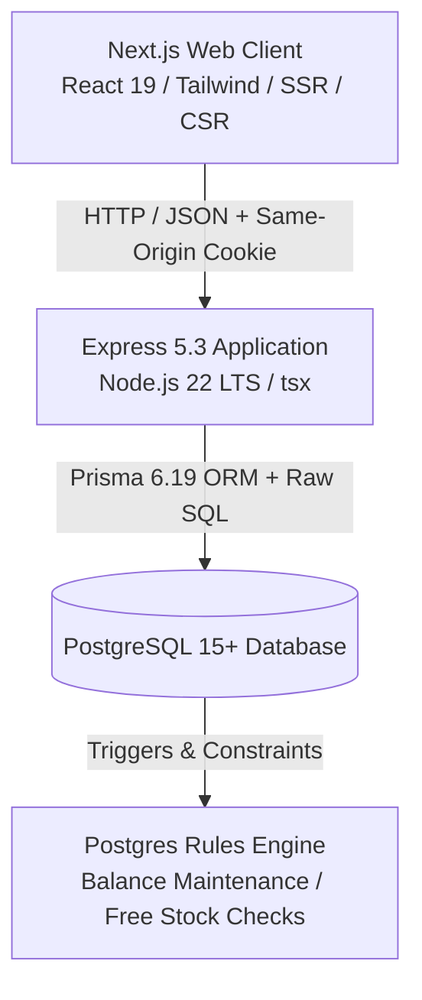
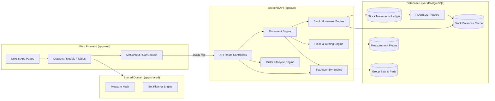
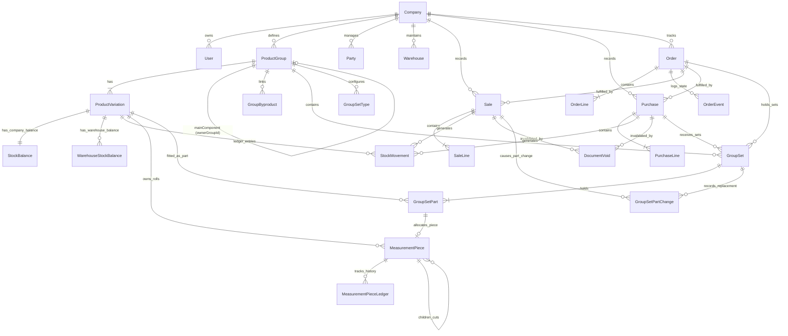

# SYSTEM ARCHITECTURE MAP
**Project:** RS Machinery Inventory Management System  
**Audit Date:** 2026-10-28  
**Auditor:** Principal Software Architect & Senior Data Engineer  
**Scope:** `measurement-inventory/` repository (V3.1 / V3.2 codebase)

---

## 1. Executive Summary & Technology Stack

The RS Machinery Inventory Management System is a specialized multi-tier web application built to manage industrial machinery, parts, counted items, measurement-based continuous goods (wire ropes, chains, hoses), and grouped assemblies (chain hoists, lever blocks, custom sets).

### 1.1 Technology Stack Details

| Layer | Technology | Version | Architectural Role & Implementation Details |
|---|---|---|---|
| **Runtime** | Node.js | v22.x LTS | Execution environment running ESM modules natively via `tsx`. |
| **Backend API** | Express.js | 5.3.0 | RESTful API server handling authentication, validation, domain services, transactions. |
| **Database ORM** | Prisma Client | 6.19.3 | Schema management, migrations, basic CRUD queries, relation fetching. |
| **Database Engine** | PostgreSQL | 15+ / 16 | ACID transaction coordinator, stored running balances, PL/pgSQL triggers, deferrable constraints. |
| **Validation** | Zod | 3.25.76 | Runtime request/response payload validation, parsing, coercion, and domain invariants. |
| **Security & Auth** | bcryptjs / helmet / cookie-parser | 3.0.3 / 8.3.0 | Password hashing, secure HTTP headers, HttpOnly authenticated session cookies. |
| **Frontend Framework** | Next.js | 15.x / React 19 | Client/Server React rendering, App Router (`app/(app)`), React Context state. |
| **UI Styling** | Tailwind CSS / PostCSS | 3.4 / 8.4 | Utility-first responsive styling with custom design tokens for mobile/desktop. |
| **Shared Domain** | `@rs-v31/shared` | Internal | Pure TypeScript utilities for unit conversions, set planning algorithms, formatting. |
| **Testing** | Vitest | 3.2.7 | Unit and integration test suites with isolated company isolation. |

---

## 2. Application Component Architecture

The codebase is organized as a multi-package workspace located in `measurement-inventory/app`:
- `app/api`: Express backend, Prisma schema, migrations, domain services, route handlers.
- `app/shared`: Shared pure functions (measurement math, set algorithms, types).
- `app/web`: Next.js frontend, UI components, client context, modals, views.

---

## 3. Architecture Inventory: Modules & Responsibilities

| Component | Responsibility | Inputs | Outputs | Data Accessed | Dependencies | Main Callers |
|---|---|---|---|---|---|---|
| **`documents.ts`** | Core commercial document engine (sales, purchases, returns, voids, revisions). | `DocumentBody`, `EditDocumentBody`, `DocContext` | Document ID, generated document number, status | `Sale`, `SaleLine`, `Purchase`, `PurchaseLine`, `StockMovement`, `DocumentVoid` | `stock.ts`, `measure.ts`, `sets.ts`, `warehouses.ts`, `vendor-prices.ts`, `audit.ts` | `routes/documents.ts`, `routes/orders.ts` (`fulfillOrder`) |
| **`stock.ts`** | Stock movement ledger engine, balance validation, concurrency locking. | `MovementInput[]`, `RecordOptions` | Void / Commit receipts | `StockMovement`, `StockBalance`, `ProductVariation`, `WarehouseStockBalance` | `warehouses.ts`, `audit.ts`, `errors.ts` | `documents.ts`, `transfers.ts`, `routes/inventory.ts` |
| **`measure.ts`** | Measured goods engine (rolls, cutting, lineage, scrap write-off, piece ledger). | Cut lengths, piece IDs, roll manifests | Cut pieces, updated roll remaining lengths, piece ledger rows | `MeasurementPiece`, `MeasurementPieceLedger`, `ProductVariation` | `stock.ts`, `audit.ts`, `numbering.ts` | `documents.ts`, `sets.ts`, `routes/measure.ts` |
| **`sets.ts`** | Grouped product set lifecycle, opening sets, sales allocation, part replacement. | `SetInput[]`, `SaleSetLine[]`, `groupId` | Created/updated set codes, status changes | `GroupSet`, `GroupSetPart`, `GroupSetPartChange`, `ProductGroup`, `MeasurementPiece` | `stock.ts`, `measure.ts`, `warehouses.ts`, `audit.ts` | `documents.ts`, `orders.ts`, `routes/sets.ts` |
| **`set-types.ts`** | Standard set types, configuration, set-type price resolution, stock-in sync. | Set type specifications, counts, prices | `GroupSetType` records, price mappings | `GroupSetType`, `GroupSet`, `ProductVariation` | `sets.ts`, `stock.ts` | `routes/sets.ts`, `sets.ts` |
| **`orders.ts`** | Customer/supplier order management (drafts, placement, delivery, holds). | `createOrderBody`, `fulfillOrderBody` | `Order` entity, linked delivery documents | `Order`, `OrderLine`, `OrderEvent`, `GroupSet` | `documents.ts`, `order-sync.ts`, `sets.ts`, `stock.ts` | `routes/orders.ts` |
| **`order-sync.ts`** | Bi-directional order-document synchronization and status reconciliation. | `orderId`, document links | `OrderSyncResult` (status transitions, quantities) | `Order`, `OrderLine`, `Sale`, `Purchase`, `DocumentVoid` | `versions.ts` | `documents.ts`, `orders.ts` |
| **`warehouses.ts`** | Multi-warehouse balance management, default locations, warehouse splits. | Warehouse configurations, line splits | Warehouse balances, split suggestions | `Warehouse`, `WarehouseStockBalance`, `StockMovement` | `db.ts` | `stock.ts`, `documents.ts`, `transfers.ts` |
| **`transfers.ts`** | Inter-warehouse stock transfers and transfer voids. | Transfer manifest (items, source, destination) | `StockTransfer`, transfer movements | `StockTransfer`, `StockTransferLine`, `StockTransferVoid`, `StockMovement` | `stock.ts`, `warehouses.ts` | `routes/warehouses.ts` |
| **`products.ts` & `product-create.ts`** | Catalog maintenance, variation matrix generation, code uniqueness. | Product/variation specifications | Serialized catalog groups and variations | `ProductGroup`, `ProductVariation`, `Category`, `Image` | `category-heads.ts`, `images.ts`, `audit.ts` | `routes/products.ts`, `routes/catalog.ts` |
| **`inventory-query.ts`** | High-performance catalog rollups, stock status filters, inventory valuation. | Filter parameters (`q`, `categoryId`, `state`, pagination) | Filtered product rollups, KPIs, tab counts | `ProductGroup`, `ProductVariation`, `StockBalance`, `GroupSet`, `MeasurementPiece` | `category-heads.ts`, `product-activity.ts` | `routes/inventory.ts`, `routes/catalog.ts` |
| **`backup.ts`** | Deterministic zip export and restore for entire company dataset. | Raw zip bytes / Company ID | Backup zip archive / Restoration receipt | All 26 system tables | Raw PostgreSQL transactions, trigger overrides | `routes/backup.ts` |

---

## 4. Comprehensive Data Model

The schema is maintained in PostgreSQL via Prisma migrations (`0001_foundation` through `0041_set_type_prices`).

### 4.1 Entity Relationship Diagram

---

## 5. Authoritative Sources of Truth vs. Derived State

| Business Fact | Authoritative Source of Truth | Cached / Derived Representation | Consistency Mechanism | Invariant & Failure Risk |
|---|---|---|---|---|
| **Inventory Quantity** | `stock_movements` (Append-only ledger) | `stock_balances.quantity`, `warehouse_stock_balances.quantity` | PostgreSQL Trigger `stock_movements_maintain_balance` (BEFORE INSERT/DELETE) | `stock_balance_drift` view detects drift. Disabling triggers during restore can corrupt balance if not recomputed. |
| **Free Stock Available** | Calculated: `StockBalance - SUM(ALLOCATED GroupSetPart)` | In-memory calculation in `freeBalances()`, SQL CTE in `inventory-query.ts` | Application logic + PostgreSQL Constraint Trigger `set_parts_free_stock` (DEFERRED) | Prevents loose sales from stealing parts physically fitted in assembled sets. |
| **Measured Continuous Stock** | `measurement_pieces` (ACTIVE pieces where `remaining_length > 0`) | `StockBalance` of measured variation | Check constraint: `SUM(ACTIVE pieces) == StockBalance` | Pieces can never be joined. Rounding mismatch between fractional meters and integer paise avoided via integer thousandths (`milli`). |
| **Physical Set Composition** | `group_set_parts` where `status = 'ALLOCATED'` | Set display name serialized in API / snapshot on `sale_lines` | Unique constraint: exactly 1 MAIN part per set; 1 part per byproduct link | Part replacement updates `group_set_parts` and logs immutable `group_set_part_changes`. |
| **Grouped Product Selling Price** | Bifurcated: `group_set_types.sale_price` (Primary since 0041) vs `product_variations.sale_price` (Legacy fallback) | `typePrices` dictionary returned by `/api/sets` | Application fallback hierarchy | Risk of inconsistent pricing if user updates base product price but set type price remains static. |
| **Historical Line Price & Cost** | `sale_lines.unit_price`, `purchase_lines.unit_cost`, `line_total` | Snapshots in `audit_events` | Immutable once committed (except via explicit Document Revision `-R<n>`) | Historical invoices never reflect post-sale catalog price updates. |
| **Order Delivery Status** | Sum of `quantity` across live (non-voided) `sale_lines` / `purchase_lines` linked via `order_line_id` | `orders.status`, `order_lines.fulfilled_quantity` | `syncOrderFromDocuments()` executed inside document commit transaction | If sync is omitted or fails, order status drifts from actual document shipments. |

---

## 6. Transaction Boundaries & Isolation

All critical business operations execute inside PostgreSQL ACID transactions coordinated via Prisma:
`prisma.$transaction(async (tx) => { ... }, { maxWait: 5000, timeout: 30000, isolationLevel: "ReadCommitted" })`

### 6.1 Concurrency & Locking Hierarchy
To prevent deadlocks between concurrent sales, purchases, order holds, and warehouse transfers, the system enforces a strict global acquisition order:
1. **Order Row Lock:** `SELECT id FROM orders WHERE id = ... FOR UPDATE`
2. **Product Variation Locks (Alphabetical by ID):**  
   `SELECT v.id FROM product_variations v WHERE v.id = ANY(ids) ORDER BY v.id FOR UPDATE OF v`
3. **Group Set Row Locks (Alphabetical by ID):**  
   `SELECT id FROM group_sets WHERE id = ANY(ids) ORDER BY id FOR UPDATE`
4. **Document Row Locks (during Void/Revision):**  
   `SELECT id FROM sales WHERE id = ... FOR UPDATE`

---

## 7. Major Architectural Decisions & Context

1. **Relational Ledger with Database-Enforced Balance Cache (Migration 0007):**  
   Rather than summing millions of ledger movements on every screen load, the system stores running balances in `stock_balances`, maintained synchronously via database row triggers.
2. **First-Class Measured Domain (Migrations 0020–0029):**  
   Continuous goods (wire ropes, chains) are tracked as discrete physical parent/child pieces (`measurement_pieces`) with independent cutting lineage, length units (`m`, `ft_in`), and integer millimetric precision.
3. **Physical Set Architecture vs. Virtual Kits (Migrations 0030–0041):**  
   Grouped products are represented as tangible physical assemblies (`group_sets`), not abstract bills-of-material. Stock is consumed at set creation (purchase/opening), fitted parts are locked to the set, and components can only be changed via formal release/cut workflows.
4. **Append-Only Document Revisioning (Migration 0024):**  
   Commercial documents (sales, purchases) are never mutated in place. Edits create a replacement document with revision suffix (`INV/2026-27/0001-R1`), atomically voiding the parent with `REPLACED` status and reversing original stock movements.

